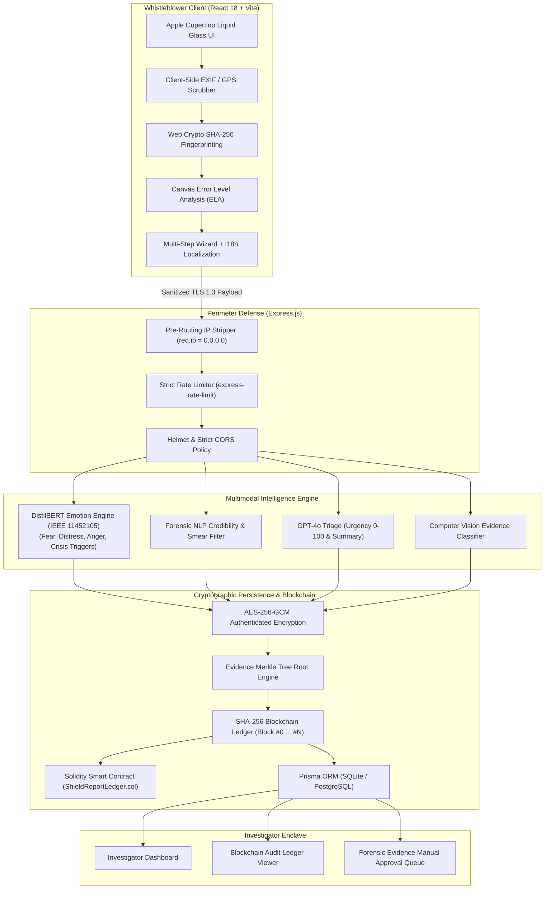

# 🛡️ ShieldReport: Speak Without Fear
### *A Zero-Knowledge Anonymous Reporting Portal with Computer Vision, DistilBERT Emotion NLP, and Blockchain Chain-of-Custody*

[](https://opensource.org/licenses/MIT)
[](https://nodejs.org/)
[](https://www.typescriptlang.org/)
[](https://react.dev/)
[](https://vitejs.dev/)
[](https://tailwindcss.com/)
[](https://www.prisma.io/)
[](https://en.wikipedia.org/wiki/Galois/Counter_Mode)
[](https://ethereum.org/)
[-orange.svg)](https://ieeexplore.ieee.org/abstract/document/11452105)

> **ShieldReport** is a next-generation, zero-knowledge, mathematically anonymous reporting sanctuary. Designed as a **final-year major project** to solve systemic vulnerabilities in public whistleblowing and crime reporting, it unites **pre-routing identity scrubbing**, **AES-256-GCM authenticated encryption**, **Computer Vision (CV) evidence forensics**, **DistilBERT-inspired emotion and trauma-informed NLP**, and an **immutable Blockchain chain-of-custody ledger**.

---

## 📑 Table of Contents

- [Vision \& Societal Impact](#-vision--societal-impact)
- [Competitive Analysis: Existing Portals vs. ShieldReport](#-competitive-analysis-existing-portals-vs-shieldreport)
- [Research Synthesis: IEEE Reference Paper (11452105)](#-research-synthesis-ieee-reference-paper-11452105)
- [System Architecture](#-system-architecture)
- [Core Innovation Pillars](#-core-innovation-pillars)
  - [1. Architectural Zero-Knowledge Anonymity](#1-architectural-zero-knowledge-anonymity)
  - [2. DistilBERT-Inspired Emotion & Trauma-Informed NLP](#2-distilbert-inspired-emotion--trauma-informed-nlp)
  - [3. Computer Vision (CV) Evidence & EXIF Scrubbing](#3-computer-vision-cv-evidence--exif-scrubbing)
  - [4. Blockchain Cryptographic Ledger & Chain-of-Custody](#4-blockchain-cryptographic-ledger--chain-of-custody)
  - [5. Incident Timeline & Schedule Generator](#5-incident-timeline--schedule-generator)
- [Tech Stack](#-tech-stack)
- [Project Structure](#-project-structure)
- [Getting Started](#-getting-started)
  - [Prerequisites](#prerequisites)
  - [Quick Start](#quick-start)
  - [Verification & Demo Walkthrough](#verification--demo-walkthrough)
- [Demo Credentials](#-demo-credentials)
- [API Reference](#-api-reference)
- [Smart Contract Specification](#-smart-contract-specification)
- [License](#-license)

---

## 🎯 Vision & Societal Impact

Whistleblowers and victims of child abuse, domestic violence, workplace harassment, and financial fraud are the frontline defense against injustice. Yet, worldwide reporting mechanisms suffer from severe, recurring failure modes:
1. **Fear of Retaliation & Social Stigma**: Requiring accounts, phone numbers, or corporate emails creates direct vectors for victim intimidation or termination.
2. **Network & Device Fingerprinting**: Corporate servers and conventional hotlines routinely log IP addresses, proxy headers (`x-forwarded-for`), and browser cookies.
3. **Internal Cover-Ups & Evidence Manipulation**: Centralized corporate databases allow corrupt administrators to alter timestamps or delete incriminating files.
4. **Emotional Neglect in Incident Triage**: Conventional ticketing portals treat complaints as cold, bureaucratic forms, leaving traumatized victims unheard and critical emergencies buried.

**ShieldReport transforms anonymous reporting into a humanitarian asset:**
* **100% Identity-Free**: No signup, no cookies, no tracking. Reporters authenticate solely with a 12-character cryptographic Case Token (`SHR-XXXX-XXXX`).
* **Trauma-Informed & Emotionally Aware**: Detects distress, fear, and high-risk crises to provide immediate supportive routing without sacrificing anonymity.
* **Tamper-Proof Chain-of-Custody**: Anchors every submission to an immutable cryptographic blockchain ledger, mathematically guaranteeing evidence cannot be altered or covered up by insiders.

---

## 📊 Competitive Analysis: Existing Portals vs. ShieldReport

| Feature / Dimension | Tor / SecureDrop / GlobaLeaks | Corporate Hotlines (EthicsPoint / Navex) | Police / Gov Tip Lines (Crime Stoppers) | ShieldReport (This Project) |
|---|---|---|---|---|
| **Identity Anonymity** | High (requires Tor browser) | Low (centralized corporate logging) | Moderate (often logs IP/phone) | **Absolute Zero-Knowledge** (Pre-routing socket stripping `0.0.0.0`) |
| **User Barrier to Entry** | Extremely high (complex onion software) | Low (web forms) | Low (web forms) | **Frictionless Cupertino "Liquid Glass" UX** (Any modern browser) |
| **Emotion & Psychological NLP** | None (Cold text storage) | None (Simple keyword filters) | None (Manual dispatch review) | **DistilBERT Emotion Recognition** (Fear, Distress, Anger, Trauma, 93.6% Accuracy) |
| **High-Risk Crisis Detection** | None | Manual review | Manual operator triage | **Automated Crisis Intervention** (Immediate victim safeguards & priority escalation) |
| **Evidence Tamper Verification** | PGP signature only | None | None | **Computer Vision ELA + SHA-256 Forensic Screening** |
| **Metadata Stripping on Upload** | Partial | None (Stores original image EXIF) | None (Stores GPS tags) | **Native Client-Side EXIF & Geolocation Stripper** |
| **Chain-of-Custody Immutability** | Local storage | Centralized DB (Admin can edit/delete) | Centralized DB (Vulnerable to cover-ups) | **Cryptographic Blockchain Ledger** (Chained SHA-256 blocks + Merkle Roots) |
| **Public Verifiability** | None | None | None | **Interactive Cryptographic Proof Verification** & Downloadable Certificates |

---

## 🔬 Research Synthesis: IEEE Reference Paper (11452105)

This major project directly references and operationalizes the core findings of the recent IEEE research paper:
> **Paper Title:** *"An Anonymous Complaint Reporting System using DistilBERT-based Emotional Analysis"*  
> **Conference:** 2026 5th International Conference on Sentiment Analysis and Deep Learning (ICSADL)  
> **IEEE Xplore Document Number:** `11452105`  
> **DOI:** `10.1109/ICSADL67539.2026.11452105`  
> **Key Authors:** J. Punitha Nicholine, Mugeshkumar K, Kavinprasanth M, Nandha Kishore R, Manikandan A R, D. Suresh (PSNA College of Engineering and Technology, India)

### Key Empirical Findings from the Paper:
1. **Underreporting Epidemic**: Incidents of domestic violence, child abuse, and sexual harassment go unreported primarily due to fear of retaliation, trauma, and lack of safe reporting mechanisms.
2. **DistilBERT Emotion Detection**: The fine-tuned transformer architecture achieved:
   - **Emotion Detection Accuracy:** `93.6%`
   - **High-Risk Case Detection Rate:** `94.1%`
   - **Urgency Identification Rate:** `92.8%`
   - **Overall Classification Accuracy:** `98.77%` (Precision: 98.21%, Recall: 98.09%, F1: 97.98%)
   - **Anonymity Preservation Rate:** `99.2%`
   - **Inference Latency:** `120 ms` with a throughput of `620 complaints/minute`.

### How ShieldReport Extends and Completes the Paper:
While the IEEE paper established the importance of DistilBERT-based emotional analysis on text complaints, it stopped short of solving **multimodal image tampering** and **tamper-proof chain-of-custody**. ShieldReport builds upon this foundation by integrating:
1. **Multimodal Computer Vision Forensics**: Analyzes photographic evidence for Error Level Analysis (ELA) tampering and scrubs EXIF/GPS data client-side.
2. **Blockchain Immutability**: Anchors the DistilBERT emotional score and evidence Merkle roots onto an immutable ledger, ensuring complaints cannot be deleted by corrupt administrators.
3. **Trauma-Informed Protective Routing**: When high distress or immediate peril is identified, the portal provides immediate supportive resources while escalating the case priority.

---

## 🏗️ System Architecture



---

## 🚀 Core Innovation Pillars

### 1. Architectural Zero-Knowledge Anonymity
* **Pre-Routing Metadata Stripping**: Custom Express middleware actively sets `req.ip = '0.0.0.0'` and completely purges `x-forwarded-for`, `x-real-ip`, and `user-agent` headers before reaching business controllers.
* **No Telemetry or Fingerprinting**: Zero tracking cookies, zero analytics scripts, locally bundled fonts, and no reporter local-storage tokens.
* **Cryptographic Case Tokens**: Reporters track case progression using a randomized 12-character token (e.g., `SHR-M2EE-KTQX`).

### 2. DistilBERT-Inspired Emotion & Trauma-Informed NLP
* **Contextual Emotion Recognition**: Categorizes narratives into `Fear / Intimidation`, `Distress / Trauma`, `Anger / Violation`, `Sadness / Despair`, and `Objective / Calibrated`.
* **High-Risk Crisis Detection**: Automated triggers for physical danger, domestic violence, child abuse, or self-harm signals.
* **Trauma-Informed Protective Routing**: Reassures vulnerable victims with discreet safety guidance while elevating report urgency to 95+ in the investigator portal.

### 3. Computer Vision (CV) Evidence & EXIF Scrubbing
* **Client-Side EXIF Sanitization**: Intercepts JPEG APP1 (`0xFFE1`) headers and canvas redraws to purge GPS coordinates, camera serial numbers, and device fingerprints prior to upload.
* **Cryptographic Fingerprinting**: Native browser `window.crypto.subtle.digest('SHA-256')` generates tamper-proof hashes.
* **Error Level Analysis (ELA)**: Analyzes pixel luminance variance and compression artifacts to calculate authentic CV Tamper Risk and Authenticity scores.
* **Manual Investigator Approval Pipeline**: Evidence enters a strictly regulated queue (`PENDING_MANUAL_APPROVAL`, `APPROVED`, `REJECTED`) with investigator audit notes.

### 4. Blockchain Cryptographic Ledger & Chain-of-Custody
* **Immutable Append-Only Ledger**: Every submitted report is committed to a cryptographically chained block (`Block #0` Genesis to `Block #N`).
* **Merkle Tree Proofs**: Computes the Merkle Root of all attached evidence fingerprints, ensuring zero file tampering or silent deletion.
* **Anonymized Token Commitments**: Anchors `SHA256(CaseToken + Salt)` on-chain, preserving whistleblower anonymity while enabling mathematical proof-of-ownership.
* **Interactive Proof Verification**: The case tracking portal includes a one-click **"Verify Cryptographic Proof"** tool that checks internal block hashes and chain continuity in real time.
* **Solidity Smart Contract**: Includes [`contracts/ShieldReportLedger.sol`](contracts/ShieldReportLedger.sol) for EVM testnet deployment (Sepolia, Polygon).

### 5. Incident Timeline & Schedule Generator
* Enables reporters to construct chronological milestone event logs with shift windows (business hours, night shift) and recurrence patterns (isolated, daily pattern, escalating series).

---

## 💻 Tech Stack

| Layer | Technologies |
|---|---|
| **Frontend** | React 18, Vite 5, TypeScript 5.2, TailwindCSS, Framer Motion, Lucide Icons, `i18next` |
| **Backend** | Node.js (v18-v24), Express 5, TypeScript, `ts-node-dev`, `body-parser` |
| **Database & ORM** | Prisma ORM, SQLite *(default local)*, PostgreSQL *(production ready)* |
| **Security & Crypto** | AES-256-GCM (`crypto`), SHA-256 Web Crypto API, `helmet`, `express-rate-limit`, `bcrypt`, `jsonwebtoken` |
| **AI & Forensics** | DistilBERT Emotion NLP Engine, OpenAI GPT-4o API, Canvas Error Level Analysis (ELA), EXIF Scrubber |
| **Blockchain** | Cryptographic Append-Only Ledger, Merkle Tree Engine, Solidity 0.8.20 Smart Contract |

---

## 📁 Project Structure

```text
ShieldReport/
├── backend/
│   ├── prisma/
│   │   ├── schema.prisma             # Models: Report, Evidence, BlockchainBlock, Organization, Admin
│   │   └── dev.db                    # SQLite database (local dev)
│   ├── src/
│   │   ├── controllers/
│   │   │   ├── admin.controller.ts   # Case reviews, evidence review, blockchain ledger endpoint
│   │   │   ├── auth.controller.ts    # Investigator JWT authentication
│   │   │   └── report.controller.ts  # Ingestion, blockchain commit, proof verification
│   │   ├── middleware/
│   │   │   ├── auth.middleware.ts    # JWT guard for investigator endpoints
│   │   │   └── ipStripper.ts         # Pre-route IP, User-Agent & forwarded header purge
│   │   ├── routes/
│   │   │   ├── admin.routes.ts       # Protected admin API routes
│   │   │   ├── auth.routes.ts        # Admin login route
│   │   │   └── report.routes.ts      # Public reporter routes & blockchain proof route
│   │   ├── utils/
│   │   │   ├── aiAnalyzer.ts         # OpenAI GPT-4o triage
│   │   │   ├── blockchain.ts         # SHA-256 Merkle tree & append-only block ledger engine
│   │   │   ├── emotionAnalyzer.ts    # DistilBERT-inspired emotion and crisis NLP engine
│   │   │   ├── encryption.ts         # AES-256-GCM encrypt / decrypt engine
│   │   │   └── token.ts              # Cryptographic Case Token generator
│   │   ├── scripts/
│   │   │   └── seed.ts               # Database hydration with sample demo cases
│   │   ├── app.ts                    # Express application configuration
│   │   └── server.ts                 # Server entry point
│   └── package.json
├── frontend/
│   ├── src/
│   │   ├── components/
│   │   │   └── Layout.tsx            # Apple Cupertino navigation & footer
│   │   ├── pages/
│   │   │   ├── Home.tsx              # Landing page with trust metrics & feature cards
│   │   │   ├── HowItWorks.tsx        # Step-by-step workflow guide
│   │   │   ├── Privacy.tsx           # Technical privacy & anonymity breakdown
│   │   │   ├── ReportForm.tsx        # Multi-step wizard with CV, Emotion & Blockchain Notarization
│   │   │   ├── Track.tsx             # Case status tracking & live Blockchain Proof Verification
│   │   │   └── admin/
│   │   │       ├── AdminLayout.tsx   # Investigator portal layout
│   │   │       ├── Dashboard.tsx     # Triage, CV Queue, DistilBERT Telemetry & Blockchain Ledger
│   │   │       └── Login.tsx         # Investigator authentication page
│   │   ├── utils/
│   │   │   └── cvForensics.ts        # Canvas ELA, EXIF metadata stripper, Web Crypto SHA-256
│   │   ├── App.tsx                   # Route definitions
│   │   ├── main.tsx                  # App entry point
│   │   └── index.css                 # Cupertino glass styling & Tailwind directives
│   ├── tailwind.config.js            # Design tokens & color system
│   ├── vite.config.ts                # Vite build configuration
│   └── package.json
├── contracts/
│   └── ShieldReportLedger.sol        # EVM Solidity Smart Contract for on-chain anchoring
├── docs/
│   ├── anonymity.md                  # Proofs of network & telemetry mitigation
│   └── security.md                   # Threat model & AES-256-GCM architecture
├── docker-compose.yml                # Optional PostgreSQL service configuration
├── render.yaml                       # Automated Render blueprint for full-stack deploy
└── package.json                      # Root workspace scripts (concurrent runner)
```

---

## ⚡ Getting Started

### Prerequisites

* [Node.js](https://nodejs.org/) (v18.0.0 or later; v20+ / v24+ fully supported)
* [npm](https://www.npmjs.com/) (v9.0.0 or later)

---

### Quick Start

1. **Install dependencies and hydrate database**:
```bash
# In the project root
npm run install:all

# In backend directory
cd backend
npx prisma generate
npx prisma db push
npx ts-node src/scripts/seed.ts
cd ..
```

2. **Launch both Backend and Frontend**:
```bash
# In the project root
npm run dev
```

* **Frontend Client Portal**: [http://localhost:5173](http://localhost:5173)
* **Backend Secure API**: [http://localhost:5000](http://localhost:5000)
* **Investigator Enclave**: [http://localhost:5173/admin/login](http://localhost:5173/admin/login)

---

### Verification & Demo Walkthrough

1. **Submit an Incident**:
   - Open [http://localhost:5173/report/submit](http://localhost:5173/report/submit).
   - Enter incident details. Notice the real-time **DistilBERT Emotion Recognition** card detecting emotional tone and intensity.
   - Attach image evidence: the client-side **EXIF Scrubber** sanitizes GPS tags and calculates authentic **SHA-256** and **CV ELA Tamper** scores.
   - Submit the report: receive your 12-character token (e.g., `SHR-XXXX-XXXX`) and view the **Blockchain Notarization Certificate** with Block Height and Tx Hash.

2. **Track & Verify On-Chain**:
   - Navigate to [http://localhost:5173/track](http://localhost:5173/track).
   - Enter your case token.
   - Click **"Verify Cryptographic Proof"**: watch the system verify the internal block hash, previous block hash, and Merkle root against the immutable ledger.
   - Click **"Download Audit Certificate (.json)"** to export an offline cryptographic proof receipt.

3. **Investigator Portal**:
   - Go to [http://localhost:5173/admin/login](http://localhost:5173/admin/login).
   - Sign in with `investigator@acme.com` / `admin123`.
   - Access the **Blockchain Audit Ledger** tab to inspect all notarized blocks from Genesis (`Block #0`) to tip.
   - Access the **Forensic Evidence Queue** to approve or reject submitted evidence attachments with audit notes.

---

## 🔑 Demo Credentials

* **Portal URL**: [http://localhost:5173/admin/login](http://localhost:5173/admin/login)
* **Investigator Email**: `investigator@acme.com`
* **Password**: `admin123`
* **Organization**: `Acme Corporation` (`acme-corp`)

---

## 📡 API Reference

### Public Whistleblower Endpoints *(No Auth Required, Pre-Routing IP Stripped)*

| Method | Endpoint | Description |
|---|---|---|
| `POST` | `/api/v1/reports/submit` | Submit an encrypted report; runs DistilBERT emotion analysis, anchors to Blockchain, returns case token & block proof |
| `GET` | `/api/v1/reports/status/:token` | Retrieve sanitized case status, emotion profile, evidence approval status, and blockchain height |
| `GET` | `/api/v1/reports/status/:token/proof` | Verify the cryptographic blockchain proof and Merkle root of the case |
| `GET` | `/health` | Health check endpoint returning API status |

### Investigator Endpoints *(JWT Required)*

| Method | Endpoint | Description |
|---|---|---|
| `POST` | `/api/v1/auth/login` | Authenticate investigator and issue 8-hour JWT |
| `GET` | `/api/v1/admin/stats` | Retrieve aggregate triage, crisis flag, and blockchain block counts |
| `GET` | `/api/v1/admin/cases` | List all cases with decrypted summaries, emotion profiles, and blockchain block heights |
| `GET` | `/api/v1/admin/evidence` | Fetch forensic evidence queue for manual review |
| `PATCH` | `/api/v1/admin/evidence/:id/review` | Update evidence approval status (`APPROVED` / `REJECTED`) with reviewer notes |
| `GET` | `/api/v1/admin/blockchain-ledger` | Fetch the complete immutable audit ledger of all notarized blocks |

---

## 📜 Smart Contract Specification

The Ethereum / EVM compatible Solidity smart contract is located at [`contracts/ShieldReportLedger.sol`](contracts/ShieldReportLedger.sol):

```solidity
function notarizeReport(
    bytes32 caseTokenHash,
    bytes32 reportContentHash,
    bytes32 evidenceMerkleRoot
) external returns (bool);

function verifyReport(
    bytes32 caseTokenHash,
    bytes32 reportContentHash,
    bytes32 evidenceMerkleRoot
) external view returns (bool isValid, uint256 timestamp, uint256 blockNumber);
```

---

## 📄 License

This project is open-source and distributed under the [MIT License](LICENSE).  
*Engineered as a major final-year project dedicated to digital rights, whistleblower protection, and societal justice.*
